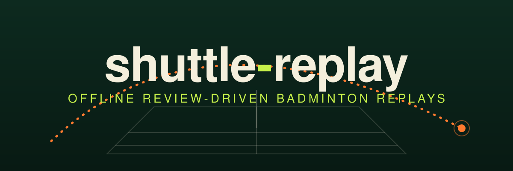
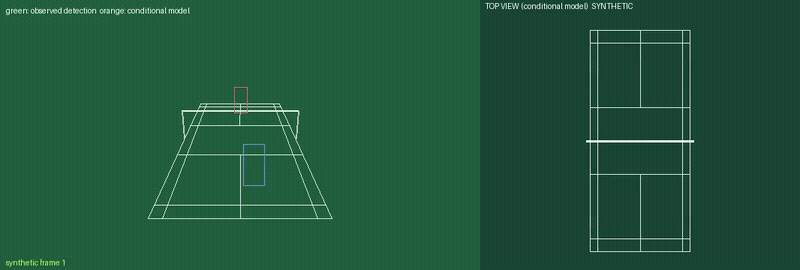

<p align="center">
  
</p>

<p align="center"><b>Transforme um vídeo local de badminton, suas detecções e sua revisão em um replay com a quadra lado a lado. Offline.</b></p>

<p align="center">
  <a href="https://github.com/kairos03/shuttle-replay/actions/workflows/ci.yml"></a>
  
  <a href="LICENSE"></a>
  
</p>

<p align="center">
  <a href="README.md">English</a> | <a href="README.zh.md">简体中文</a> | <a href="README.ja.md">日本語</a> | <a href="README.ru.md">Русский</a> | <a href="README.ko.md">한국어</a> | <a href="README.es.md">Español</a> | <a href="README.fr.md">Français</a> | <a href="README.de.md">Deutsch</a> | <a href="README.pt-BR.md">Português (Brasil)</a> | <a href="README.it.md">Italiano</a>
</p>

<p align="center">
  <a href="#quick-start">Início rápido</a> |
  <a href="#workflow">Fluxo de trabalho</a> |
  <a href="#user-guide">Guia de uso</a> |
  <a href="docs/schemas.md">Formatos de dados (em inglês)</a> |
  <a href="https://kairos03.github.io/shuttle-replay/pt-BR/">Documentação</a> |
  <a href="https://kairos03.github.io/shuttle-replay/demo/"><strong>Experimentar a demo</strong></a>
</p>

## Visão geral

`shuttle-replay` calibra uma câmera a partir de pontos da quadra que você
revisou, ajusta voos com gravidade e arrasto quadrático às detecções 2D da
peteca que você fornece e renderiza um MP4 com o vídeo original ao lado de uma
vista superior da quadra.

É uma ferramenta de pesquisa e revisão, não um sistema de marcação de linha, um
classificador de golpes, um detector de peteca nem um radar de velocidade 3D
medida. Cada posição e velocidade 3D é uma saída condicional do modelo que
depende da sua calibração e das suas anotações.

## Instalação

Requer Python 3.12+ e [uv](https://docs.astral.sh/uv/).

```bash
git clone https://github.com/KAIROS03/shuttle-replay
cd shuttle-replay
uv sync
uv run shuttle-replay --help
```

Os wheels do PyAV incluem o FFmpeg, então não é necessário FFmpeg no sistema.

## Por que usar

- **Totalmente offline.** Sem detector, sem pesos de modelo, sem chamadas de rede.
- **Revisão humana em primeiro lugar.** Contatos, regiões de queda e pontos de calibração vêm de você; nada é corrigido silenciosamente.
- **Camadas honestas.** Pixels observados, sua revisão e o modelo condicional ficam separados na saída.
- **Renderização segura.** O áudio original é copiado como fluxo sem recodificação, e arquivos existentes nunca são sobrescritos.

<a id="quick-start"></a>
## Início rápido

```bash
uv run shuttle-replay demo --out-dir demo
```

Grava `demo/inputs/` (vídeo sintético, trilhas, revisão, entrada de calibração),
`demo/calibration.json`, `demo/analysis.json`, `demo/replay.mp4`,
`demo/render_report.json` e `demo/synthetic_recovery.json`.

<p align="center">
  
  <br><sub>Demonstração sintética gerada por <code>demo</code>. Não é uma medida de precisão no mundo real.</sub>
</p>

<a id="workflow"></a>
## Fluxo de trabalho

O que você precisa fornecer para o seu próprio vídeo:

- **Detecções** (`tracks.json`): uma entrada por quadro decodificado com PTS,
  id do segmento de câmera, pixel da peteca ou null e caixas de jogadores
  opcionais. Não há detector embutido.
- **Entrada de calibração**: por segmento, pelo menos 4 pontos de quadra `fit`,
  alguns pontos `heldout` e o topo dos dois postes da rede (1.55 m).
- **Revisão** (`review.json`): tempos de contato, pixels e alturas que você
  revisou, além de regiões de queda opcionais. Os contatos não são encontrados
  automaticamente.

```bash
uv run shuttle-replay calibrate calibration_input.json -o calibration.json
uv run shuttle-replay run --video match.mp4 --tracks tracks.json --review review.json \
    --calibration calibration.json --out-dir out
```

<a id="user-guide"></a>

<details>
<summary><b>Guia passo a passo para o seu próprio vídeo</b></summary>

1. **Detecções.** Produza uma entrada de `tracks.json` por quadro decodificado
   com o PTS do quadro, um id de segmento de câmera (null para cortes ou
   closes), o pixel da peteca (ou null) e caixas de jogadores opcionais. Veja
   [docs/schemas.md](docs/schemas.md) (em inglês).
   Qualquer rastreador pode ser usado; por exemplo, você mesmo pode rodar o
   TrackNetV3 (MIT) para a peteca e um modelo YOLO da Ultralytics (AGPL-3.0)
   para os jogadores com seus próprios checkpoints e converter as saídas. Scripts
   de conversão não fazem parte da v0.1.
2. **Entrada de calibração.** Para cada segmento de câmera, meça ≥ 4
   interseções de linhas da quadra (papel `fit`), mais algumas como `heldout`, e
   o topo dos dois postes da rede (1.55 m).

   ```bash
   uv run shuttle-replay calibrate calibration_input.json -o calibration.json
   ```

   Confira `heldout_summary` e `net_anchor_sensitivity` antes de prosseguir.
3. **Revisão.** Escreva `review.json`: tempos de contato dentro de intervalos
   revisados, priors de pixel e altura do contato e, para o último voo de um
   segmento, uma região de queda opcional ou `open`.
4. **Analisar e renderizar.**

   ```bash
   uv run shuttle-replay analyze --tracks tracks.json --review review.json \
       --calibration calibration.json -o analysis.json
   uv run shuttle-replay render --video match.mp4 --analysis analysis.json -o replay.mp4
   # or both at once:
   uv run shuttle-replay run --video match.mp4 --tracks tracks.json --review review.json \
       --calibration calibration.json --out-dir out
   ```

   Entradas inconsistentes (PTS não monotônicos, segmentos não contíguos,
   contatos fora do seu segmento ou intervalo, PTS que não correspondem ao
   vídeo, …) interrompem a execução com código de saída 2 e uma mensagem; nada é
   corrigido silenciosamente.

</details>

<details>
<summary><b>O que cada comando faz</b></summary>

- **Calibração** (`calibrate`): homografia a partir de ≥ 4 pontos do piso
  revisados, mais a coluna vertical da câmera a partir de ≥ 2 âncoras elevadas
  da rede. Pontos do piso reservados nunca são usados no ajuste e são
  reportados separadamente (em pixels e metros). Entradas degeneradas,
  duplicadas, colineares e não finitas são rejeitadas. A homografia do piso
  nunca é usada para pontos no ar.
- **Análise** (`analyze`): um voo por contato revisado, cronometrado a partir
  do contato revisado (tempo zero) mesmo quando a primeira detecção chega
  depois. Usa os PTS originais, ids de quadro e ids de segmento de câmera;
  cortes de câmera são excluídos e os voos nunca atravessam segmentos. Cada voo
  termina no próximo contato (interceptado, sem ser forçado a cair), em uma
  região de queda revisada (uma restrição, não uma coordenada medida) ou na
  última observação do segmento. Verificações de piso e rede rejeitam ajustes
  inviáveis. Quando um voo foi interceptado, o ponto do piso que ele *teria*
  alcançado é reportado separadamente como contrafactual. Detecções ausentes
  continuam null.
- **Renderização** (`render`): verifica cada quadro original decodificado
  contra os PTS das trilhas, desenha as caixas de jogadores fornecidas, os
  anéis da peteca observada (verde) e do modelo (laranja), e uma quadra em vista
  superior em um layout 6:4 entre original e vista superior. Quadros com corte
  de câmera não recebem sobreposição da peteca. Os pacotes de áudio originais
  são copiados como fluxo sem alteração (sem recodificação), então o
  deslocamento inicial e as lacunas do áudio original são mantidos; a
  renderização falha se o áudio não puder ser copiado para o MP4 ou se sua
  temporização mudar. Nenhum comando de shell é montado a partir de nomes de
  arquivo. As saídas nunca são sobrescritas: a renderização falha se a saída já
  existir ou apontar para o arquivo original, grava em um arquivo temporário
  único e só o publica após uma verificação completa de decodificação.
- **Demo** (`demo`): gera um rali totalmente sintético (duas câmeras virtuais,
  um corte de câmera, detecções ruidosas com lacunas, um tom de teste) e executa
  todo o pipeline, incluindo um relatório de recuperação da verdade de
  referência sintética.

</details>

<details>
<summary><b>Como ler a saída</b></summary>

| Camada | Significado |
| --- | --- |
| `observed_pixel` | detecção fornecida, sem alteração; null quando ausente |
| `human_review` | seus contatos, regiões de queda e pontos de calibração |
| `conditional_model` | modelo físico ajustado aos pixels observados sob seus priors |
| `display_interpolation` | linhas e marcadores desenhados apenas pelo renderizador |

As velocidades são a velocidade inicial do modelo ajustado (`model_speed_km_h`,
exibida arredondada para 5 km/h). Trate-as como valores aproximados do modelo.

</details>

<details>
<summary><b>Limitações</b></summary>

- Sem detecção de peteca ou de jogadores. Você fornece as detecções no
  [formato de trilhas](docs/schemas.md) (em inglês); nenhum peso de modelo é
  baixado.
- Sem detecção automática de contatos nem refinamento dos seus timestamps.
- Sem mapas de profundidade densa aprendidos, sem rótulos de golpe aprendidos,
  sem marcações automáticas de IN/OUT.
- A saída 3D é condicional, não medida. Um erro de reprojeção baixo mostra
  consistência com as detecções 2D, não uma prova independente de precisão 3D.
  Resultados de recuperação sintética são sintéticos.

</details>

<details>
<summary><b>Desenvolvimento</b></summary>

```bash
uv run pytest
uv run ruff check .
uv run ruff format --check .
```

</details>

<details>
<summary><b>Licença</b></summary>

GNU Affero General Public License v3.0 only (`AGPL-3.0-only`). Veja
[LICENSE](LICENSE) e [NOTICE.md](NOTICE.md) para os avisos de terceiros.

</details>
